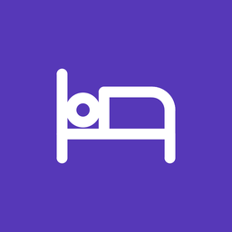
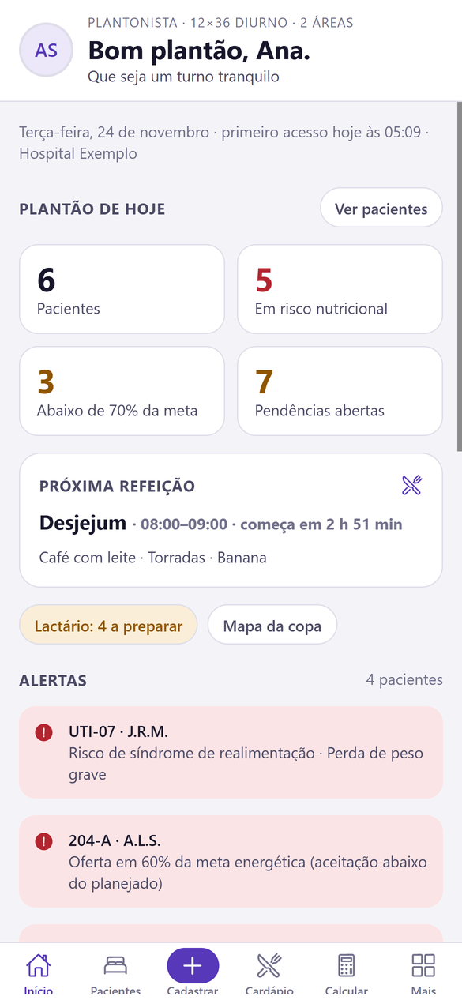
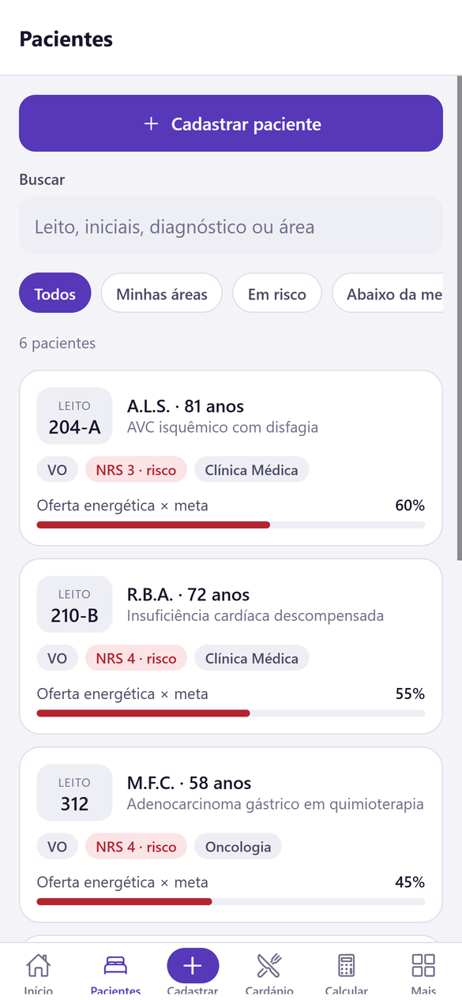
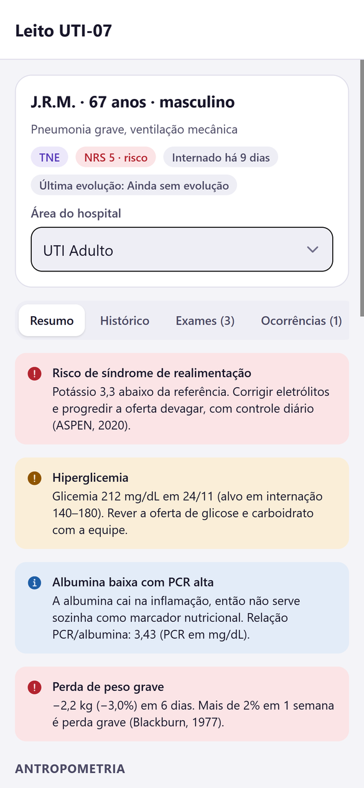
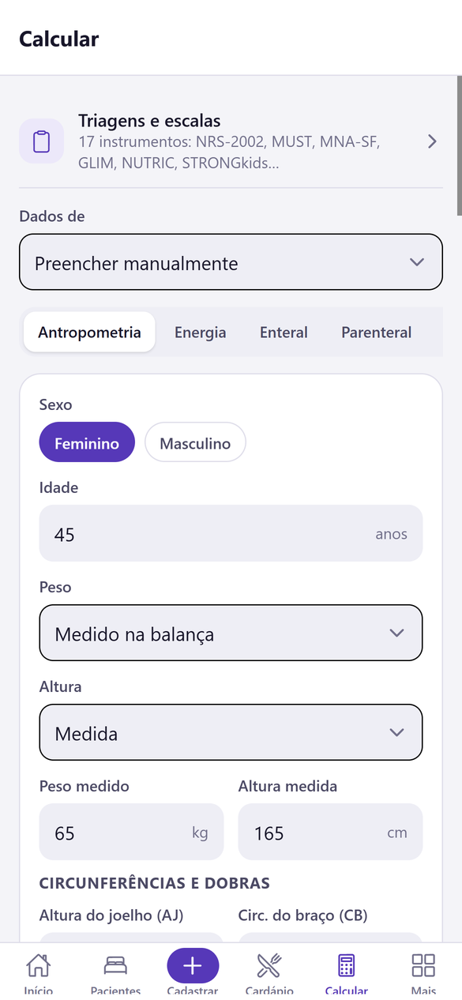
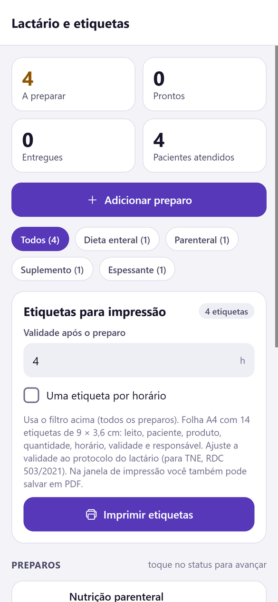
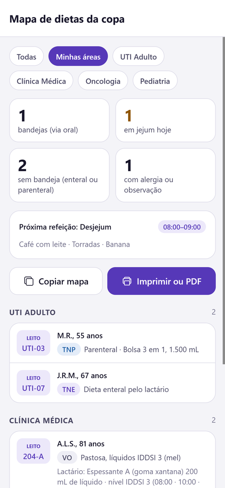
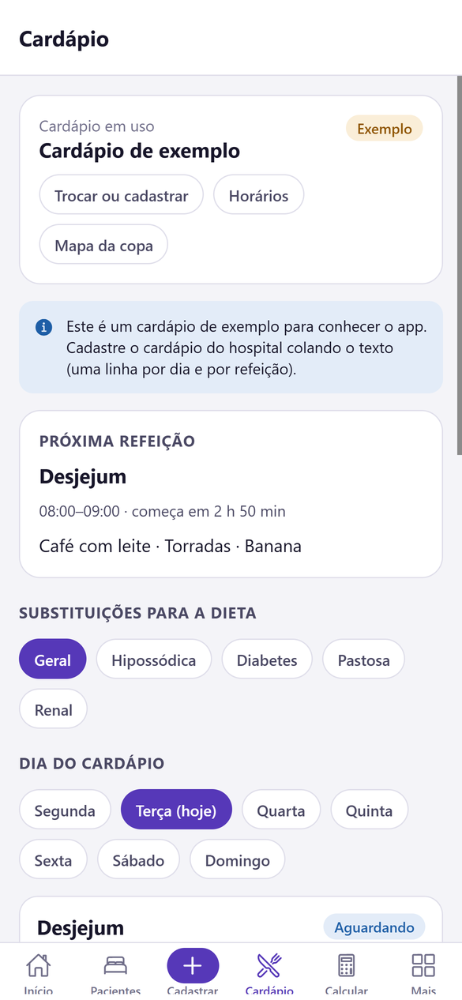
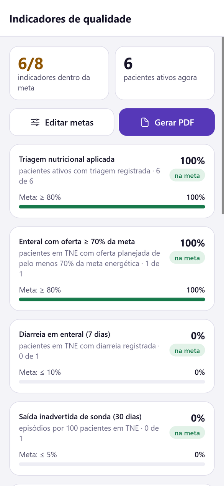

  

<h1 align="center">Beira Leito</h1>

  <b>A rotina do nutricionista hospitalar no celular.</b> 
  Pacientes, triagens, cálculos de terapia nutricional, evolução, lactário, mapa da copa e relatórios, no mesmo lugar e sem depender de internet.

  <i>Em desenvolvimento · lançamento previsto para 2027 (Android primeiro)</i>

---

## Telas

<table>
  <tr>
    <td align="center"> Início do plantão</td>
    <td align="center"> Pacientes por área</td>
    <td align="center"> Ficha com alertas clínicos</td>
  </tr>
  <tr>
    <td align="center"> Calculadoras</td>
    <td align="center"> Lactário e etiquetas</td>
    <td align="center"> Mapa de dietas da copa</td>
  </tr>
  <tr>
    <td align="center"> Cardápio e substituições</td>
    <td align="center"> Indicadores de qualidade</td>
    <td></td>
  </tr>
</table>

Pacientes fictícios. Os pacientes aparecem só com iniciais e leito, como no uso real.

## O que o app faz

**Para diaristas e plantonistas.** O Início, as áreas e as pendências se ajustam ao vínculo e ao turno de cada profissional.

- **Pacientes por área e leito**, só com iniciais (LGPD), com meta energética e proteica, adequação da oferta e alertas.
- **17 triagens e escalas**: NRS-2002, MUST, MNA-SF, GLIM, NUTRIC, STRONGkids e outras, com registro no paciente.
- **Calculadoras** de antropometria, energia, enteral, parenteral e hídrica, sempre com método e referência.
- **Evolução nutricional** pronta para copiar no prontuário, pendências do turno e histórico de peso e oferta com gráficos.
- **Exames com alertas** (realimentação, hiperglicemia, albumina × PCR) e **intercorrências** (diarreia, saída de sonda, jejum).
- **Lactário**: a dieta enteral e a parenteral entram sozinhas a partir da prescrição; suplementos, espessantes e fórmulas são cadastrados; etiquetas para imprimir.
- **Cardápio do hospital** por foto (leitura no próprio celular) ou por texto, com substituições por dieta e a refeição que está sendo servida.
- **Mapa de dietas da copa** com jejum do dia, alergias e itens do lactário, para copiar ou imprimir.
- **Alta e desfecho** com resumo nutricional para o prontuário e **indicadores de qualidade** (IQTN) com metas.
- **Fim do plantão**: passagem para a próxima equipe e relatório em PDF.
- **Funciona sem internet.** Com a conta (Google, Microsoft ou Apple), sincroniza com a equipe do hospital.

## Como foi feito

| | |
|---|---|
| **App** | React Native com Expo (SDK 58), TypeScript e Expo Router · um código para Android, iPhone e web |
| **Dados** | Banco local no aparelho (SQLite): o app grava primeiro no celular e funciona offline |
| **Servidor** | Supabase (Postgres) na região de São Paulo, com regras de acesso por hospital (RLS), login OAuth com PKCE e convites da equipe |
| **Sincronização** | Motor próprio: envia e recebe só o que mudou, última gravação vence, tolera relógio errado do celular |
| **Leitura por foto** | Reconhecimento de texto no aparelho (ML Kit no Android, Vision no iPhone), sem enviar a foto |
| **Documentos** | Etiquetas, mapa da copa, indicadores e relatório gerados em PDF |
| **Qualidade** | Regras clínicas em funções puras com 138 testes automáticos, incluindo testes de conformidade com o protótipo validado |
| **Publicação** | EAS Build e EAS Submit |

## Privacidade e segurança

- Pacientes só com iniciais, leito e prontuário: o app não pede nome completo, CPF nem contato.
- Toda ação relevante fica registrada numa auditoria que o app não deixa apagar.
- Cada pessoa só acessa os dados dos hospitais de que faz parte.
- A foto do cardápio é lida no celular e não sai dele.

## Etapas

1. Base: perfil, áreas e pacientes, tudo offline ✅
2. Triagens e calculadoras ✅
3. Evolução, pendências, histórico, exames e intercorrências ✅
4. Lactário, etiquetas, cardápio e mapa da copa ✅
5. Alta e desfecho, indicadores, relatório de plantão, login e sincronização ✅
6. Cardápio por foto e publicação nas lojas 🚧

## Sobre

Idealizado e desenvolvido por **Murillo Matos Marques**, nutricionista (CRN 88175).

O código-fonte é privado. Este repositório é a vitrine do projeto.
Interesse em conhecer, testar ou levar o Beira Leito para o seu hospital? Fale comigo pelo GitHub.

© 2026 Murillo Matos Marques. Todos os direitos reservados.
